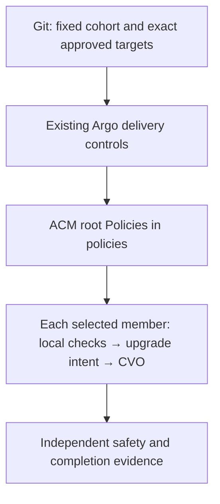

# Customer design: one Git-approved cohort of up to ten clusters

**Proposal, not a ten-cluster qualification result.** Use this design to prepare an implementation review and a real concurrency rehearsal. The runnable examples elsewhere in this repository have narrower scopes.

## Scope and component ownership

Use one reviewed list of one to ten non-hub managed clusters. Resolve eligible update recommendations for an approved channel and version boundary, then approve the exact target for each member in Git. Hold upgrade enforcement disabled during channel preparation and freeze targets for the run. Do not continually chase a moving latest version or force an arbitrary payload when recommendations are empty.

Prefer AutoShift's existing native CVO upgrade path for the customer integration. It avoids adding the hub-side status bridge needed by the separate ClusterCurator example. Do not enable both upgrade writers on the same cluster. The operator edits YAML configuration; this proposal adds no Go template code, Ansible dependency, new CRD, annotation protocol, generic scheduler, or fleet queue. [AutoShift upgrade design](https://github.com/auto-shift/autoshiftv2/blob/main/docs/ocp-upgrade.md)

Pin and inspect the actual installed releases and generated resources. Root Policies belong in the intended hub namespace `policies`; ACM manages replicas in target namespaces. This document does not claim that the proposed AutoShift integration is implemented by the repository's standalone examples.

## Execution model

Use shared root Policies with per-cluster evaluation. The selected member's readiness must gate its own upgrade; it must not depend on another member's readiness. Keep the safety path independent of admission. A fleet-wide Argo health barrier between deploying prechecks and requests can defeat that independence, so inspect the actual delivery graph.

Constrain selection to the exact reviewed list and inspect all PlacementBindings and PlacementDecisions. A selection count of ten is not a count of active upgrades. Freeze membership during execution and do not replace a failed member with an eleventh target. Account for other active upgrade writers before making any overall concurrency statement.

## Checks and operation

1. **Prepare the hub and members.** Review shared hub health separately from spoke-local checks. Do not deploy hub-only service assertions to every spoke. Verify supported target paths, resource presence, usable observations, critical alerts, disruption-budget/image-pull concerns, and the required recovery/application prerequisites. Healthy ClusterOperators alone do not cover every admission concern.
2. **Approve exact intent.** Store the selected members and resolved targets in Git. Record architecture and payload identity where relevant. Avoid imperative changes to AutoShift-owned labels. Keep unreviewed conditional/candidate exceptions outside the customer default.
3. **Admit independently.** Preserve the existing target-validation gates and add only missing local readiness checks. Use native Policy Dependencies and keep Pending unresolved. A failed member is recorded as blocked while other eligible members can proceed.
4. **Observe the run.** Distinguish actual accepted/progressing CVO work from a successful configuration write. Correlate findings to the current version, generation, and operation. Use the [attended lifecycle](policy-lifecycle.md) to keep consumed admission separate from ongoing safety and final postchecks.
5. **Verify outcomes.** Check the latest CVO history entry, intended target, required current conditions, actual operator inventory, pool counts/configuration, nodes, and application outcome. A compliant request Policy or Argo Synced is not completion.
6. **Close the cohort.** Record a verified completed, blocked/not-started, or investigated failed outcome for each member. Withdraw further upgrade intent through its owning Git source. Preserve evidence without deleting platform objects or active execution resources as cleanup.

Where supported and authorized, the read-only `oc adm upgrade recommend` command can support preflight review. A hub-only workflow needs an explicitly assigned equivalent monitoring review for remote clusters. Direct ClusterVersion enforcement does not prove CLI-side checks have run. Do not silently bypass warnings because the desired version appears in the update graph.

For the first implementation, use existing Governance details, Argo delivery status, and a per-cluster run table. Separate admission, progress, safety findings and completion. These are operating terms, not new ACM compliance states; Disabled and Pending do not mean passed.

## Maintenance timing

An Argo CD window can permit Monday 06:00 delivery in an explicit timezone. It does not create a new approved target each week, expire persistent approval, guarantee a downstream CVO start time, or cancel active work. A blocked or disconnected cluster can act later on already-delivered intent.

If every upgrade step must actually start inside an allowed interval, executor-side admission and safe deferral must be delivered and validated separately. This requirement cannot be claimed complete from a sync-window example. Multi-step minor/EUS journeys also need their own supported-path and deferral qualification. [Argo CD Sync Windows](https://argo-cd.readthedocs.io/en/stable/user-guide/sync_windows/)

## Acceptance before a customer capacity claim

| Rehearsal | Required outcome |
|---|---|
| One real member | Approved upgrade completes and independent health evidence agrees |
| Two members | One blocked precheck does not hold the other eligible member |
| Ten eligible members | Ten actual CVO upgrade intervals overlap; record start/finish evidence |
| Non-member | An otherwise eligible eleventh cluster receives no intent from this solution |
| Failed member | In a separate run, one blocked member does not prevent the other nine progressing |
| Evidence loss/recovery | Missing or stale evidence is not accepted as passed; repeated delivery/restarts do not create unintended work |
| Resource pressure | Measure propagation/admission delay and hub, controller, registry, network and observability headroom |
| Timing | Demonstrate delivery controls and separately establish whether actual start deadlines are met |

A canary followed by nine parallel upgrades does not prove ten-way overlap. Creating ten objects, ten Policy replicas, or ten execution Jobs does not establish the required capacity either. Agree acceptable delays and resource headroom for the real environment before the rehearsal.

## Implementation and maintenance

Prepare one scoped integration change against a pinned AutoShift version: explicit cohort selection, local precheck dependencies, independent safety/completion placement, clear phase interpretation, and a runbook. Keep one execution owner and preserve existing target guards. Qualify any attended phase toggles in the owning Git source rather than inventing unsupported configuration fields.

Assign policy correctness, AutoShift/GitOps integration, qualification infrastructure, customer operations and documentation ownership explicitly. The maintenance surface should remain the small policy graph, per-cluster Git values, compatibility qualification and runbook. Do not turn the policy maintainers into owners of an incidental orchestration service or custom dashboard.

The customer design is ready for handover only after its installed configuration, actual ten-way execution, failure isolation, operating ownership and required timing behavior have been established.
