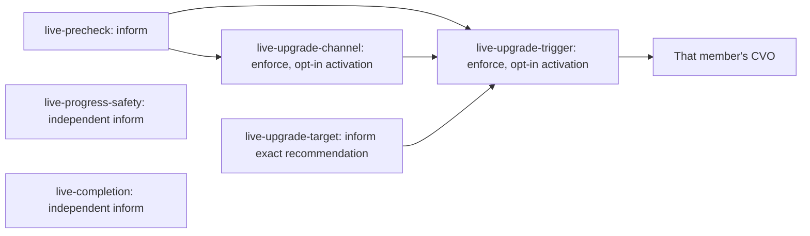

# Native Policy Dependencies and label fan-out

The examples reuse the root `spec.dependencies` and template `extraDependencies` patterns from [policydependencydemo](https://github.com/ch-stark/policydependencydemo/tree/d7ecb5bb11adbea22cabba7688c5da00aa1f54ec). They are native YAML; no Policy Generator installation or Go template code is added by this repository.

## Eligibility and execution location

The label contract is `ManagedCluster.metadata.labels.shouldupgrade: "true"`. Without that exact value, neither example path selects the member. The synthetic demo also selects only the local hub; the real-upgrade path excludes that hub role and selects all eligible spokes in bound cluster sets. There is no hardcoded ManagedCluster name or first-cluster limit.

ACM Placement performs the inventory selection and policy fan-out. Root Policies live in `policies`, while each target evaluates its own replicated Policy and local ClusterVersion. This supplies the required iteration without a script or an all-cluster hub template. [OCM Placement API](https://pkg.go.dev/open-cluster-management.io/api/cluster/v1beta1)

## Fields used

| Field | Meaning here |
|---|---|
| `spec.dependencies` | Require another Policy's compliance before this Policy's templates can act |
| `spec.policy-templates[].extraDependencies` | Gate one template on an additional compliant object |
| `spec.policy-templates[].ignorePending: false` | Keep unmet dependencies unresolved rather than treating them as passed |

Policy dependencies explicitly name the root namespace `policies`. ConfigurationPolicy extraDependencies omit namespace; ACM resolves them in the relevant managed policy namespace.

## Real-upgrade graph

All the following Policies select the same opted-in spokes:

The request depends on `live-precheck`, `live-upgrade-channel`, and `live-upgrade-target` being Compliant on the same member. It does not read a hub aggregate as if it represented one particular member. A failed member cannot satisfy its own gate, while another eligible member can progress.

The channel request and upgrade request start disabled. Templates use `pruneObjectBehavior: None`; dependency loss or retirement must not delete platform objects. Target recommendations may disappear after consumption; an admitted update can continue even when admission later becomes Pending. Dependencies are continuously reevaluated conditions, not a transaction or durable execution history.

Safety and completion do not depend on a precheck remaining healthy or a window remaining open. Keep the `shouldupgrade` label while these observations are needed: label removal withdraws their placement too and does not cancel accepted execution.

## Synthetic graph and manual checks

The synthetic demo keeps root precheck → admission ordering and completion template 1 → template 2 ordering via ConfigurationPolicy extraDependencies. Progress safety stays independent.

From reviewed Git source, exercise:

1. `08-precheck-blocked`: admission template Pending because its Policy dependency is unmet.
2. `02-ready-window-open`: admission Compliant; completion target template NonCompliant and its dependent template Pending.
3. `03-upgrading`: safety Compliant with incomplete completion evidence.
4. `04-upgrade-failed`: independent safety NonCompliant while completion is unresolved.
5. `06-completed-window-closed`: completion Compliant even with admission closed.
6. `07-stale-observation`: synthetic freshness failure blocks admission and fails safety.

The synthetic flag is not timestamp validation for real observations. Inspect per-cluster template details; exact console aggregation varies by installed version. For a hub demo, the replicated Policy name is prefixed by its source namespace, for example `policies.upgrade-02-window-admission`, in the local ManagedCluster's namespace on the hub.

## What must still be verified

The baseline positively checks ClusterVersion and core operator presence, but absence assertions alone cannot establish complete optional-operator/pool inventory, known conditions, backup/application readiness or observation freshness. Review the actual installed platform and current evidence. Completion must be corroborated by the latest CVO history entry and full convergence; an older history entry is insufficient.

Do not use Pending aggregation, disabled checks, lower severity, or blanket exclusions to claim success. Label/placement reconciliation is asynchronous and is not an executor-side start deadline. See [label selection and migration](label-selection.md), [policy lifecycle](policy-lifecycle.md), and the [manual checklist](manual-checklist.md).

## Earlier deployments

The old named-spoke/ClusterCurator hub bridge used different Placements and bindings. Leaving them installed can bypass the new label boundary or retain a competing writer. Disable its trigger and follow the [migration procedure](label-selection.md#migrate-the-earlier-example) before activation. Moving a root Policy's namespace also leaves the old object behind; inspect and retire only this repository's owned earlier resources through their Git owner. Never delete managed-cluster namespaces or active lifecycle objects as migration cleanup.
