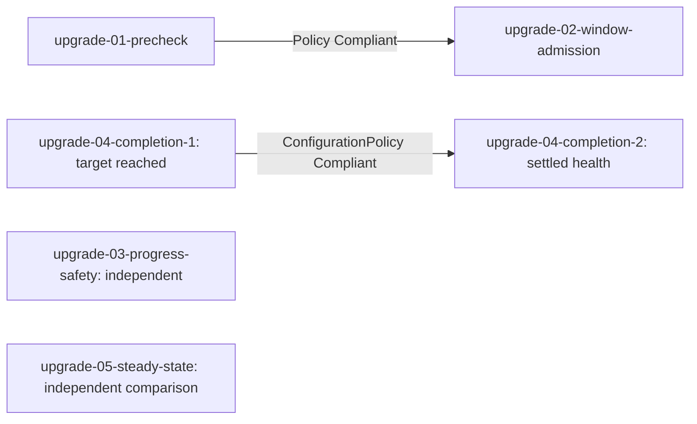
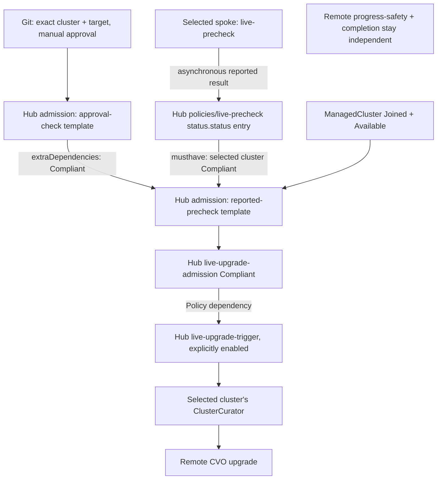

# Native Policy Dependency: implementation and manual test

## What we reuse

Reference: [ch-stark/policydependencydemo at d7ecb5b](https://github.com/ch-stark/policydependencydemo/tree/d7ecb5bb11adbea22cabba7688c5da00aa1f54ec), specifically its root Policy dependencies, template ConfigurationPolicy extraDependencies, and intentionally unresolved dependencies. This repository writes the resulting native YAML directly. It does not install the reference's Policy Generator or its broad cluster selection.

| Field | Use here | Reference detail |
|---|---|---|
| `spec.dependencies` | Gate all templates of admission/trigger on another Policy | Root Policy references explicitly use `namespace: policies` |
| `spec.policy-templates[].extraDependencies` | Order templates inside completion/admission | ConfigurationPolicy references omit namespace; ACM resolves them in its managed-cluster namespace |
| `spec.policy-templates[].ignorePending: false` | Keep blocked checks visibly unresolved | `true` only changes compliance aggregation; it does not execute or pass a blocked check |

Example from the real trigger:

```yaml
dependencies:
  - apiVersion: policy.open-cluster-management.io/v1
    kind: Policy
    namespace: policies
    name: live-upgrade-admission
    compliance: Compliant
```

Native dependencies wait on the referenced object's compliance on the evaluating cluster. They are continuously reevaluated conditions, not a durable workflow history, execution order based on file names, a transaction, or a cluster upgrade scheduler. A dependency becoming unmet after execution does not roll back its effects.

## Namespace ownership

| Location | Resources | Ownership |
|---|---|---|
| Hub `policies` | Root Policies, Placements, PlacementBindings | This repository owns only its explicitly named resources |
| Hub `policies` | Existing namespace and `global` ManagedClusterSetBinding | Shared prerequisite; never deleted by this repository |
| Hub `upgradetesting` | Synthetic ConfigMaps; optional real-test approval ConfigMap | Dedicated test data namespace created by `base/namespace.yaml` |
| Managed-cluster namespaces | ACM replicas; views and the selected curator | ACM/controller-managed or explicitly named real-test objects; never delete these namespaces |

Check the existing namespace and binding before applying. Do not change shared permissions or expand cluster-set membership without the hub administrator's review. PlacementDecisions must select exactly the intended execution cluster. The local hub needs its policy add-on; the optional remote target needs its own policy add-on and usable view agent.

## Hub-only demo



All these checks run on the local hub, all are informational, and no real upgrade is started. Completion is not gated on an open window: an operation can finish after its admission window closes. Progress safety is independent of admission and prechecks, so dependency blocking cannot hide an observed degradation.

Use the hub context and the commands from the README. Apply each scenario from reviewed Git content and wait for actual policy evaluation before drawing conclusions:

1. **`08-precheck-blocked`:** precheck NonCompliant; admission's template Pending with an unmet Policy dependency. No simulated or real upgrade action occurs.
2. **`02-ready-window-open`:** precheck and admission become Compliant. Completion template 1 is NonCompliant because the target has not been reached; template 2 is Pending on its ConfigurationPolicy dependency.
3. **`03-upgrading`:** progress safety stays Compliant; completion is not yet satisfied. This is expected transition status, not upgrade success.
4. **`04-upgrade-failed`:** progress safety becomes NonCompliant even though the completion chain is unresolved.
5. **`06-completed-window-closed`:** both completion templates become Compliant; admission is NonCompliant because the window is closed. This proves postchecks do not depend on a still-open window.
6. **`07-stale-observation`:** synthetic freshness failure blocks admission and fails safety. This is a synthetic flag, not implemented timestamp validation for real clusters.

Inspect `describe policy NAME -n policies` and Governance's local-cluster template history. A Pending template can produce overall NonCompliant; exact console presentation varies by installed version. Do not mark a blocked test passed because another policy is green.

For the actual dependency messages, also inspect the **replicated** Policy on the hub in the namespace of its selected local ManagedCluster. Replace `YOUR_LOCAL_CLUSTER_NAME` with the PlacementDecision's cluster name (usually `local-cluster`):

```bash
oc --context="$HUB_CONTEXT" get policy policies.upgrade-02-window-admission -n YOUR_LOCAL_CLUSTER_NAME -o yaml
oc --context="$HUB_CONTEXT" get policy policies.upgrade-04-completion -n YOUR_LOCAL_CLUSTER_NAME -o yaml
```

The `policies.` prefix is ACM's replicated-policy name convention; the source root Policy remains `policies/upgrade-02-window-admission`. This inspection requires only hub access. For the optional real flow, inspect `policies.live-upgrade-admission` and `policies.live-upgrade-trigger` in that same local-cluster namespace, while `policies.live-precheck` reports the target spoke's result in its namespace on the hub.

## Real upgrade: explicit bridge to the hub



`05-hub-admission.yaml.example` deliberately checks the **root Policy** at `policies/live-precheck`, matching the selected cluster's `clustername`, `clusternamespace`, and `compliant` fields in `status.status`. It does not assume that the root Policy's summary field represents a particular cluster. The root status shape is defined in the [upstream Policy API](https://github.com/open-cluster-management-io/governance-policy-propagator/blob/main/api/v1/policy_types.go).

The final dependency is local to the hub: both `live-upgrade-admission` and `live-upgrade-trigger` select the hub. A direct dependency from a hub trigger to a spoke-only precheck would not establish this chain. If the local policy controller cannot read the root Policy or ManagedCluster, the gate must remain unresolved/noncompliant; investigate its actual permissions, without granting broad new access just to get green results.

The manual approval ConfigMap starts with both approval fields `'false'`. It binds approval to the exact static cluster and target. Review all duplicated values together; plain YAML does not enforce consistency between files. Keep the trigger disabled until the admission policy is verified. Before applying to any existing installation, revoke approval and deliver the disabled trigger first; do not rely on resource application order to neutralize a previously active trigger.

For a fresh disposable test configuration, an optional negative test is to enable the trigger **with approvals still false**, then verify its template stays Pending and no curator is created by it. An existing curator is not proof of a failed dependency: inspect its ownership and history. Return the trigger to disabled before proceeding to approval. Never perform this negative test against an existing active upgrade.

### Boundaries that require manual judgment

- `status.status` and ManagedCluster availability are asynchronously reported. They can be stale. This static configuration does not correlate evidence to the current Policy generation, calculate an observation TTL, or protect against a disconnected controller acting on earlier intent.
- The remote precheck uses absence assertions. Missing/Unknown operators, empty inventories, an already progressing CVO, paused pools, compatibility constraints, and application readiness require manual review of the real view results before approving. Compliant alone is insufficient.
- `windowApproved` is a persistent manual approval flag. It does not inspect the clock, expire itself, or prove that CVO starts inside an interval. Argo's sync window only gates delivery. Revoke approval through Git after the test; a closed sync window may delay that delivery.
- When prechecks cease to be Compliant during an upgrade, admission can become unresolved. Progress and completion remain active. The curator trigger uses `pruneObjectBehavior: None`; losing admission must not delete the curator or undo its existing spec.
- Completion policy compliance is supporting evidence. Manually verify the latest CVO history entry, target, operator conditions, pool counts, and application outcome as described in the README.

This is a one-cluster manual concept, not production unattended scheduling. Native Policy Dependency provides reusable gates. AutoShift remains the proposed owner of run identity, target resolution, fresh observations, per-step window authorization, concurrency, recovery, and a phase-aware UI. No new policy CRD, annotation convention, controller, or Ansible dependency is introduced by this change. AutoShift integration is future engineering work, not code included here.

## False positives in Governance

Dependencies help distinguish **blocked** from **evaluated and failed**; they do not add an `Upgrading` compliance state or suppress unrelated policies. Keep unexpected failures visible. The demo intentionally retains a strict steady-state policy to show expected rollout noncompliance. Do not use `ignorePending: true` to claim readiness or indiscriminately disable health policies. In a future AutoShift UI, show phase, blocked reason, expected incomplete postchecks, and independently failing safety findings separately, preserving raw ACM compliance.

## Migrating an earlier checkout

If nothing was applied before, skip this section. If the previous revision was applied, moving root objects to `policies` leaves old objects behind.

1. Stop the old Argo source through Git so it cannot recreate old resources. For a real test, deliver the old trigger disabled and inspect any active execution first. Disabling or removing a Policy does not cancel its curator.
2. Save evidence and inspect the old namespaces for unrelated resources. Remove **only this repository's** old root objects: the five `upgrade-01-*` through `upgrade-05-*` Policies and `hub-demo-only` Placement/PlacementBinding in `upgradetesting`; any deployed `live-precheck`, `live-progress-safety`, `live-completion`, and `live-upgrade-trigger` Policies plus `live-test-spoke`, `live-trigger-on-hub` Placements and their `live-test-spoke-health`, `live-trigger-on-hub` PlacementBindings in `upgradetesting-live`.
3. Preserve the test ConfigMaps if useful. Leave old cluster-set bindings and namespaces alone unless their ownership is separately verified. Do not delete any curator, managed-cluster namespace, or the shared `policies` namespace as part of this migration.
4. Check the existing `policies/global` binding; apply the new demo or prepared examples and inspect the new PlacementDecisions and per-cluster results. Do not leave both old and new trigger Policies active.

## Engineering follow-up after the manual test

Record ACM/MCE/OpenShift versions, commit, propagation time, dependency messages, and whether the hub admission controller can read root status. Demonstrate blocked → admitted → progressing → completed, and safety failures remaining visible when admission is lost. A real upgrade result requires a separate test cluster; hub-only results prove only the synthetic dependency behavior.

Before production work, agree with AutoShift engineering on one execution owner and prove: fresh generation-correlated evidence, durable run state, supported target resolution, bounded cluster concurrency, a start decision at **each** platform upgrade step, recovery after a missed interval, and no replay after reconnection. Policy dependencies alone do not provide those capabilities. Use this repository as the manually reviewed integration example, not as a second orchestration product maintained by the two-person policy team.
